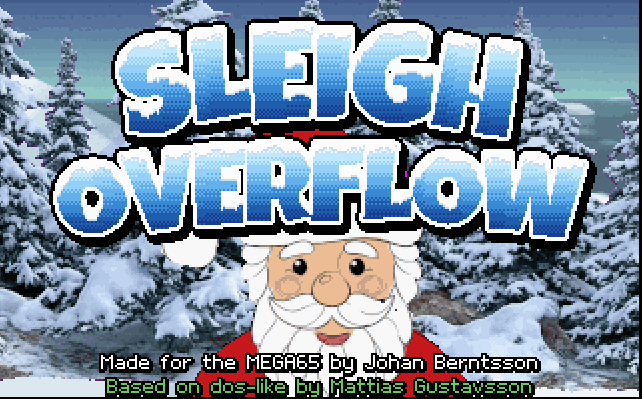

# Sleigh Overflow

    THE MEGA65 PERSONAL COMPUTER SYSTEM
    BASIC 65 V920413

    READY.
    DLOAD "SANTA"

    SEARCHING FOR SANTA
    LOADING
    READY.
    RUN

    ERROR 65 IN 2026: SLEIGH OVERFLOW

This game is based on the Stranded demo in [dos-like](https://github.com/mattiasgustavsson/dos-like)
framework by Mattias Gustavsson, ported to MEGA65 by me, but all graphics and music has been replaced
and the game play extended. 

To build the game you need [Exomizer](https://bitbucket.org/magli143/exomizer) by
Magnus Lind, for crunching; `diskutil.rb` by Fredrik Ramsberg, for the disk image;
and the [Calypsi](https://www.calypsi.cc/) C toolchain by Håkan Thörngren.

Hey, we're all Swedish developers. Sweden rulez!
